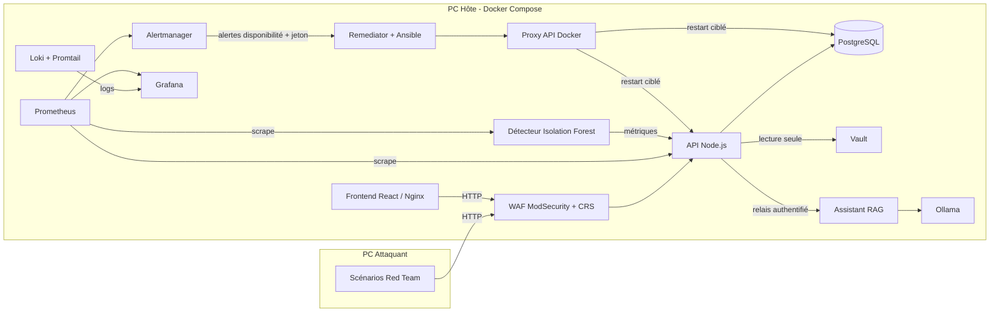

# Architecture - Resilience-Alpha

Plateforme de paiement fictive, conteneurisée, capable de détecter un incident et de se rétablir sans intervention humaine. Aucune donnée bancaire réelle.

## Vue d'ensemble

## Composants et responsabilités

| Domaine | Composant | Rôle |
|---|---|---|
| Développement | Frontend React + Tailwind + Nginx | Dashboard de paiement, connexion Face ID, état du service en direct, assistant opérateur |
| Développement | API Node.js/Express | Paiements, authentification WebAuthn, métriques Prometheus, relais assistant |
| Développement | PostgreSQL | Transactions fictives, utilisateurs et clés publiques WebAuthn |
| Développement | Remediator + Ansible | Reçoit les alertes de disponibilité, répare les conteneurs, vérifie la reprise |
| Infrastructure | Docker Compose | Déploiement reproductible, réseaux, healthchecks |
| Infrastructure | Prometheus, Grafana, Loki, Promtail | Métriques, visualisation, journaux centralisés |
| IA / Data | Isolation Forest (scikit-learn) | Détection d'anomalies de trafic, ré-entraînement sur le trafic nominal |
| IA / Data | Ollama + LangChain + RAG | Assistant local (modèle de 1,5 milliard de paramètres) sur les procédures |
| Cybersécurité | WAF ModSecurity + OWASP CRS | Filtrage applicatif devant l'API |
| Cybersécurité | HashiCorp Vault | Secrets applicatifs, token en lecture seule pour l'API |
| Cybersécurité | Dashboard SOC Grafana | Alertes de sécurité, authentification, WAF, remédiation |
| Gouvernance | Documents `docs/` | EBIOS RM, PCA/PRA, NIS2/DORA, runbook |

## Réseaux et exposition

- `resilience-net` est un réseau **interne** (sans accès Internet) : tous les services y communiquent.
- `resilience-edge` expose uniquement ce qui doit l'être : frontend 8080, WAF/API 3000, Prometheus 9090, Grafana 3001, Alertmanager 9093.
- `resilience-egress` n'est rattaché qu'à Ollama, pour télécharger les modèles. Aucun port entrant.
- Non exposés : PostgreSQL, Vault, Loki, détecteur ML, assistant, proxys Docker, remediator.

## Flux d'une transaction

1. L'opérateur se connecte avec une passkey (Face ID, Touch ID, Windows Hello) : l'API vérifie l'assertion et émet une session signée de 15 minutes.
2. Le frontend envoie `POST /payments` avec la session ; la requête traverse le WAF.
3. L'API valide la charge utile puis insère la transaction dans PostgreSQL avec une requête paramétrée.
4. Le dashboard relit les transactions et affiche l'état de santé mesuré sur `/health`.

## Flux d'un incident de disponibilité

1. `docker stop resilience-payment-api` (ou panne réelle).
2. Prometheus (scrape toutes les 5 s) constate `up == 0` ; l'alerte `PaymentApiDown` se déclenche après 5 s.
3. Alertmanager route les alertes de catégorie `availability` vers le remediator, avec un jeton Bearer.
4. Le remediator répond immédiatement puis lance le playbook : réparation dans l'ordre PostgreSQL, API ; attente de l'état `healthy` ; vérification de `/health` (`database: ok`).
5. Le dashboard affiche « Panne détectée » puis « Service rétabli, reprise automatique en N s ». Le temps mesuré est d'environ 30 s.

## Flux d'un incident de sécurité

Les alertes de catégorie `security` (rafale de requêtes invalides, anomalie ML, échecs biométriques) n'appellent **pas** le remediator : redémarrer un service ne neutralise pas un attaquant. Elles sont visibles dans Alertmanager et dans le dashboard SOC. Le WAF bloque en amont les motifs d'injection connus (réponse 403).

## Décisions d'architecture

- **Remédiation limitée et non exposée** : le remediator n'accepte que les appels portant son jeton, ne cible que deux conteneurs nommés, et n'a pas le socket Docker : il passe par un proxy qui n'autorise que les appels sur les conteneurs (pas d'exec, d'images, de volumes ni de réseaux).
- **Séparation disponibilité et sécurité** : le routage Alertmanager empêche de confondre rétablir un service et corriger une compromission.
- **Assistant sans privilèges** : lecture seule, aucun accès Docker ni base, réponses fondées sur les documents. Il ne peut pas agir sur le système.
- **Secrets** : le jeton de l'API, le secret de session et le mot de passe de base sont lus dans Vault avec un token applicatif en lecture seule ; l'API n'a plus de secret dans son environnement.

## Limites assumées

Vault tourne en mode développement (stockage en mémoire, réinjection à chaque démarrage) ; en production : stockage persistant, descellement, rotation et audit. Le proxy Docker restreint les routes mais ne filtre pas le contenu des requêtes de création de conteneur. Le WAF est réglé en niveau de paranoïa 1. Le modèle ML s'appuie sur deux signaux. Aucune certification NIS2/DORA n'est revendiquée.
